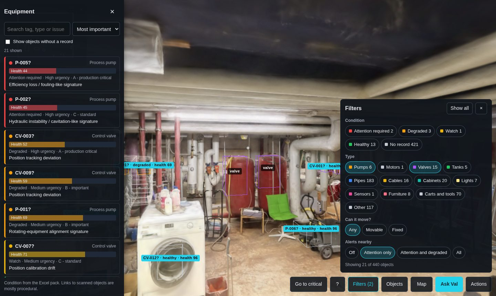
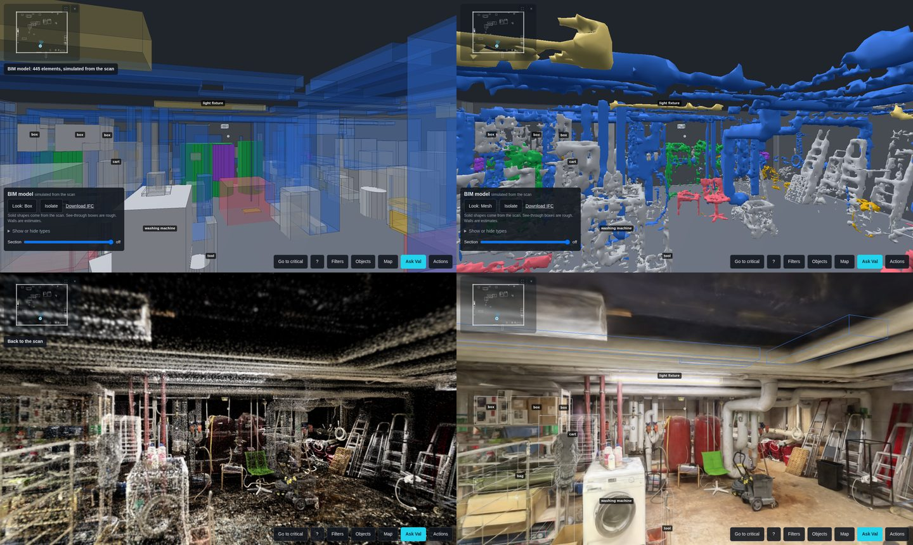
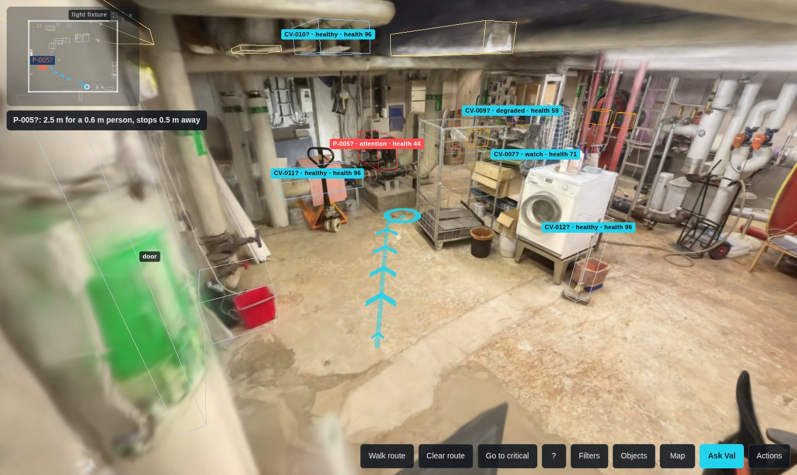
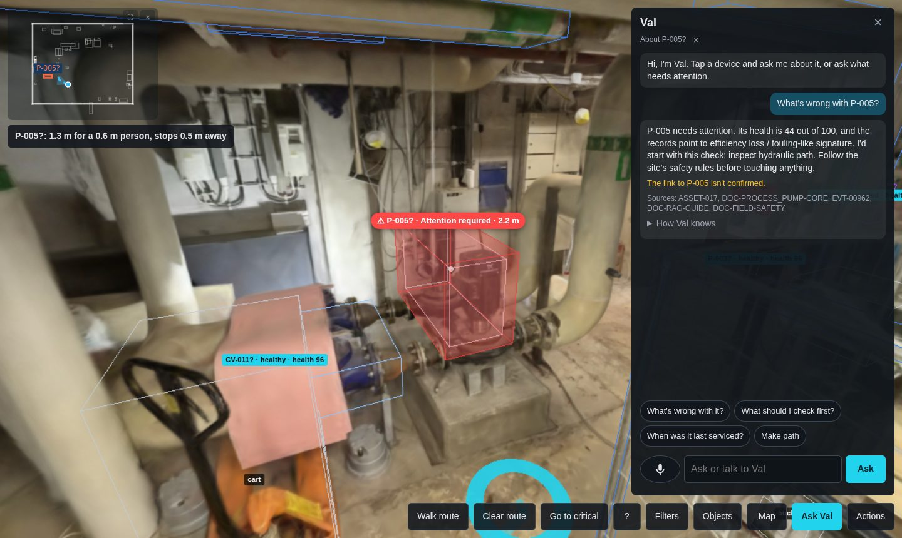
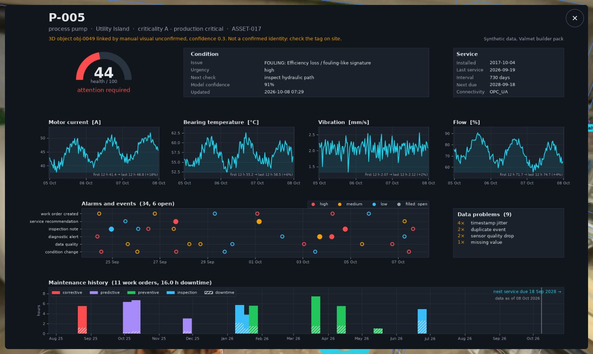

# VAL: Valmet Asset Locator

> VAL turns a 3D scan of a plant room into a digital twin. Its assistant, Val, finds the equipment
> that needs attention, guides you to it safely, and explains the fault from the plant's own records
> and data.

Team Newbies, Since AI Hackathon 2026, for Valmet's Industrial Metaverse challenge.

```bash
make demo   # downloads, sets up and starts everything; needs git, make and uv on Linux
```

## Features
- **Objects from a scan:** 440 objects found automatically in a 3D scan, each framed and named.
- **Linked to equipment records:** condition, health and service history shown on the equipment itself.
- **Val, the copilot:** ask by typing or talking. Answers come from the plant's records, with sources.
- **Collision-free routes** to the equipment that needs attention, for a person or a small robot.
- **A live room:** move, turn, split or delete objects, and the route goes around them.
- **Five views:** empty, simple BIM, blob BIM, point cloud and the real scan, with IFC and DXF export.
- **Built for the job:** filters, a minimap, an equipment list by urgency, dashboards, and a tutorial.
- **Runs on site:** one laptop, no internet, and a tablet or phone over the local network.

## The problem
When a machine starts failing in a plant room, the technician sent to fix it has to work out several
things before touching anything. Where exactly is it? What's around it? What has gone wrong before, and
what does the service history say? What's safe to do? That knowledge is spread over drawings, the
control system, maintenance records and manuals, and the room itself can be large and cramped, full of
obstacles and things that have moved since anyone last drew it.

A 3D scan captures the room as it really is, but a scan is just a picture you can walk through. It
doesn't know that the red thing in the corner is a pump, that it's been losing efficiency for a week,
or how to get to it without walking through a tank. And the companies running these plants
usually don't want their data going to a cloud service to find out.

## What we built
VAL is a pipeline that turns a scan of a room into a twin that does know those things. Nothing in it is
specific to one room: give it the scan of another plant room or factory floor, and its equipment
records, and it does the same. We built and tested it on Valmet's scan of a boiler room:

- **It knows what's in the room.** 440 objects found in the scan, each framed in 3D and named.
- **It knows what they are on record.** Valmet's equipment records are linked to the scanned objects,
  so you see each device's condition and health where it stands.
- **It knows where you can walk.** A floor map from the scan gives collision-free routes, for a person
  or a small robot, that update when things move.
- **It explains what's wrong.** **Val**, a field-service copilot you can type or talk to, answers from
  the plant's own records, says where each answer came from, and suggests safe checks. It never
  operates the plant.

All of it, Val included, runs on one laptop with no internet. A tablet or phone on the same local
network can open it too, so a technician can carry it into the room, and the plant's data never leaves
the site.

### Every object, framed
Each object gets a frame coloured by type. Equipment with a record shows its condition and health, and
equipment that needs attention glows as you approach it. Filters narrow everything at once, by type,
condition or whether it can move, and the equipment list puts what needs attention first.



### From a simple model to the real room
The same room can be shown five ways: empty, a simple BIM model of fitted shapes, a rougher model built
from the scan's surfaces, the raw point cloud, and the real scan. Press the **B** key to step through
them, or ask Val to "show the point cloud". The BIM model exports to IFC, the format CAD and BIM tools
read, and the floor plan to DXF.



### Getting to the fault
**Go to critical** plans a route to the device that needs attention most, around walls, machines and
anything that has been moved. A small map in the corner shows where you are and where you're going.
Walking the route, the equipment you pass shows its frame and status.



### Val explains it
When you arrive, Val opens by itself and explains the fault: health, likely cause, what to check first,
and the safety steps, with the record IDs it used. You can ask more: when it was last serviced, how its
sensors are trending, what the guidance says. Val also controls the view: "show only pumps", "take me to
P-005", "move the cart 2 metres left".

Here the condition, sensor readings and service history come from Valmet's sample records. In a real
plant, the same answers would draw on live data from the control system and connected IoT sensors.



Each device's full record can also be opened as a dashboard: health, sensor trends, alarms and events,
and its maintenance history.



### Changing the room
Rooms change, so objects can be moved, turned, copied, split, combined or deleted, with the mouse, the
arrow keys, touch or by asking Val. The scanned object itself moves, not just its frame: its own points
are cut out of the scan and the floor under it is filled in. A move into a wall or a machine is refused
with the reason, the route goes around the new spot, and every change can be undone.

A tutorial runs on the first visit: watch it play through, or try each step yourself.

## How it works

**Finding objects.** A scan has no objects in it, only 1.7 million coloured blobs. We render 700 views
of it, cut every view into object masks with SAM 3, and match the masks across views: 22,671 masks become 440 objects, each a set of the scan's own points with a 3D box. A
vision model running locally (Qwen) names each object from several views, and those names were checked
against close-up screenshots to correct the clear mistakes.

**Linking records.** Valmet's Excel pack describes 30 devices but not where they are, so each record is
placed on an object of the right kind, as the challenge allows: a pump record on a pump, not on a broom.
Healthy devices go near the route, so a walk passes normal equipment and ends at the fault. Every link
stores how it was made and how sure we are, and we never claim an identity we don't know.

**Finding the way.** The floor map is built from the scan in 5 cm cells, with how much room there is
at body height for a 0.6 m-wide person, or low down for a small robot. Routes are planned with A* and
stop where you can see the device. Moving an object blocks its new spot and frees its old one, and the
route updates while you drag.

**Val.** Code looks up every fact in the records first and checks each ID, tag and number. A small
language model on the laptop only puts the facts into words, and without one Val still answers from
templates. Safety rules refuse anything that would operate the plant or skip a safety step. Speech is
recognised on the laptop too, with faster-whisper, and viewer commands are matched in code, so
"hide the pipes" never depends on a model.

**The app.** A Python backend (FastAPI) serves routes, move checks, Val and the exports. The viewer runs
in any browser with three.js and Spark, which draws the scan. It stops redrawing when nothing changes
and lowers its resolution on weak graphics, so it runs on a laptop without a graphics card.

Code: [`app/extract`](app/extract) finding objects, [`app/copilot`](app/copilot) Val and the record
links, [`app/nav`](app/nav) the floor map and routes, [`app/api`](app/api) the backend,
[`web`](web) the viewer.

## Results
| | |
|---|---|
| Objects found | 440, in about 26 minutes on one GPU |
| Records linked | 20 of 30, each on an object of the right kind; all six pump records sit on pumps |
| Reachable | every object for a small robot, 384 of 440 for a person |
| Val | the expected answer on 56 of 60 test questions, and every unsafe request refused |
| Speech | 9 of 10 phrases right, with background noise added |
| Viewer | the light scene loads in about 6.5 s on a laptop with integrated graphics |

Full measurements: [`docs/RESULTS.md`](docs/RESULTS.md).

## Running it
On Linux, with `git` and `make`:
```bash
curl -LsSf https://astral.sh/uv/install.sh | sh   # if you don't have uv yet
git clone https://github.com/Sairanyx/Newbies.git && cd Newbies
make demo
```
The first run downloads Valmet's scan and Excel pack, installs only what the demo needs (no PyTorch, no
GPU), and builds the scene files: about five minutes and 2.5 GB, with internet. After that `make demo`
starts straight away, offline. When it's ready, it opens the demo in your browser by itself, with
the tutorial offered.

To use it from a tablet or phone, run `./start tablet` instead and open the address it prints on the
device, on the same network. It uses HTTPS so the microphone works, so accept the certificate warning
once.

- `make pipeline` runs a new scan through the whole extraction, with the full install and an NVIDIA GPU.
- `make bundle` builds a zip for another laptop that sets itself up on first run.

Every control, key and command is in [`docs/USAGE.md`](docs/USAGE.md).

## Limits
- The record links are placed by type, not confirmed.
- Object names were checked from screenshots by an AI model, not by a person.
- The sensor data is a sample from the records, not live data.
- The technician's position is simulated: the camera is the technician.

## More
[Usage](docs/USAGE.md) · [Architecture](docs/ARCHITECTURE.md) · [Results](docs/RESULTS.md) ·
[How it was built](docs/DEVLOG.md) · [The challenge](docs/CHALLENGE.md)

## Team
Viktor Trilar, Oleksandr Yakovlev, Eduard Rednic, Hannu Kiviranta, Benjamin Sundell

## Pre-existing work
The setup in the first commits was made before the event. Everything after was built at Since AI 2026.
Experiments on Roihu reused Python environments and model weights installed before the event.
