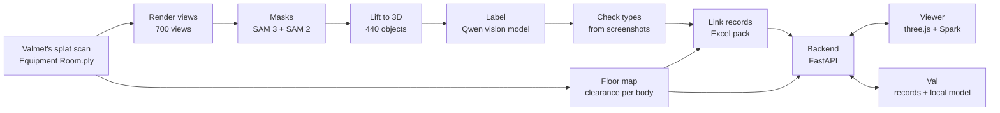

# VAL: Valmet Asset Locator

> A virtual twin of the plant room, where Val finds the faulty device, routes you there safely,
> and explains the fault from the records.

Team Newbies, Since AI Hackathon 2026, Turku, for Valmet's challenge *Industrial Metaverse: Semantic
3D Scene Understanding & Autonomous Field-Service Copilot*.

**Contents:** [Summary](#summary) · [The problem](#the-problem) · [What VAL does](#what-val-does) ·
[How it works](#how-it-works) · [Results](#results) · [Run it](#run-it) · [Limits](#limits-and-what-we-say-honestly) ·
[What's next](#whats-next) · [Repository](#repository) · [Team](#team) · [Pre-existing work](#pre-existing-work)

## Summary
VAL turns Valmet's Gaussian splat scan of an equipment room into a digital twin a field technician can use.
It finds **440 objects** in the scan and frames each one in 3D. It links the Excel pack's device records to
objects of a fitting type, and plans collision-free routes on a floor map built from the scan. On arrival at
the faulty device, **Val**, the copilot, explains the fault from the records, cites its sources, and suggests
safe checks. Objects can be moved, turned, split and combined, with their real scanned splats, and the route
re-plans around them. Everything runs on one laptop with no internet, so plant data never leaves the site.

| Brief asks for | VAL |
|---|---|
| Extract and 3D-frame as many assets as possible | 440 objects from the scan, framed and labelled. Types checked from screenshots |
| Map the Excel metadata, with a faulty target | 19 of 30 records on objects of a fitting type, each marked unconfirmed with how it was made. P-005 is the fault |
| A worker or robot walks a collision-free route | A* on a floor map from the splats, sized for a person or a robot, re-planned as objects move |
| Show nearby assets' frames and data along the way | Frames, condition and health labels, and glowing alerts near equipment that needs attention |
| AI diagnosis on arrival, grounded in the Excel pack | Val starts by itself on arrival, cites evidence IDs, gives confidence, and keeps to the safety rules |

Detailed references: [how to run and use it](docs/USAGE.md) · [architecture](docs/ARCHITECTURE.md) ·
[measured results](docs/RESULTS.md) · [the brief and our coverage](docs/CHALLENGE.md) ·
[how it was built](docs/DEVLOG.md) · [plan and copilot design](docs/PLAN.md) · [test checklist](docs/TEST_CHECKLIST.md)

## The problem
A technician walking into a plant room pieces together where things are, what condition they're in and what
to do, from drawings, the control system, maintenance logs and manuals. A 3D scan of the room looks real, but
it doesn't know what anything is: there are no objects in it, no floor, and no link to any record. Robots
have the same problem, and plants don't want their data sent to a cloud to solve it.

## What VAL does

### Five views of one room
The same room as darkness, a simple BIM of fitted shapes, a blob BIM from the scan's surfaces, the point cloud,
and the real scan. **B** steps through them, or Val does: "show the point cloud".


### Find what matters
Every object has a frame coloured by type. Linked equipment is labelled with its condition and health, and
equipment needing attention glows as you come near. **Filters** narrow frames, labels, the list, the map and
BIM at once, by type, condition or mobility. The **Objects** list puts what needs attention first. **Focus**
flies to an object's best view, chosen on the floor map with a clear line of sight.


### Go to the fault
**Go to critical** plans a route to the critical device, P-005 in this demo, sized for a 0.6 m person or a
low robot, around walls, machines and anything moved. Walking it shows nearby equipment's frames and status,
and the see-through minimap shows the walls, fixed equipment, the target, the route and where you are.


### Val explains it
Arriving at the fault starts Val. It answers from the records: what needs attention, the maintenance logs,
sensor trends, the service guidance and what to check first, always with the safety steps. Every answer lists
its sources, says how sure it is, and keeps what's recorded apart from what it infers. Val refuses to operate
the plant or skip a safety step. You can type or talk to it, with speech recognised on the device, and it
runs the viewer too: "show only pumps", "take me to P-005", "move it 2 metres left", "move it next to the
other chair".


**Dashboard** draws a device's whole record as charts: health, sensor trends, alarms and events, and the
maintenance history.


### Change the room
Objects can be moved, turned, raised, copied, named, split, combined and deleted, with the mouse, arrow keys,
touch or voice. Their own scanned splats move with them, and the floor under them is filled in. Moves into
walls or equipment are refused, with the reason, and the route goes around the new spot. Every change is
logged, so it can be undone one at a time.

### BIM, IFC and DXF
The simulated BIM model, built from the scan, exports to IFC4: the whole model as it stands now, only what's
shown, or just the selected object. The floor plan exports to DXF.

### A tutorial
The first visit offers a tutorial: **Watch** plays all 22 steps, and **Try it myself** points at each control
and waits, with **Show me**. It puts everything back afterwards.

## How it works



### 1. Extracting objects
Views are rendered from the splat at two heights. SAM 3 and SAM 2 cut each view into masks, which are lifted
to 3D by matching them across 700 views: 22,671 masks become 440 objects, each a set of splats with a box.
A local vision model (Qwen) labels each object from several views, and a review of every non-pipe object from
screenshots corrects clear mistakes. Movable objects get their mobility from their type, and some are cut out
of the scan in advance so dragging moves the real thing. Code: [`app/extract/`](app/extract),
[`app/scene/`](app/scene).

### 2. Linking the records
The Excel pack describes 30 devices with no real positions, so links are procedural, as the brief allows.
Each record goes to one object of a fitting type, with healthy devices placed nearest the route so a walk
passes normal equipment and ends at the fault. A pump record can sit on a pump or its motor, never on a light;
records with nothing fitting stay unlinked. Every link stores its method and confidence, and shows as
unconfirmed with a "?". Code: [`app/copilot/mapping.py`](app/copilot/mapping.py).

### 3. Navigation
A floor map at 5 cm cells comes from the splats: free floor, and clearance at body height for a person or low
for a robot. A* finds the route, which stops at a viewing point facing the device. Moved objects block their
new spot and free their old one, deleted objects free theirs, and routes re-plan live while you drag.
Code: [`app/nav/`](app/nav).

### 4. Val
Code fetches every fact from the records and checks every ID, tag and number. A local language model (Gemma
on a laptop, Qwen on a GPU) only words the answer, and without one Val answers from templates. Safety rules
refuse operating the plant, bypassing interlocks and made-up answers. Speech-to-text uses faster-whisper on
the CPU. Viewer commands are matched in code, so "hide the pipes" never reaches a model.
Code: [`app/copilot/`](app/copilot).

### 5. Backend and viewer
A FastAPI backend serves routes, move checks, best views, changes with undo, Val, speech, IFC and DXF, with an
optional TimescaleDB for telemetry and changes. The viewer is three.js with Spark for the splats, in any
browser with WebGL2. It stops redrawing when nothing changes, and lowers its resolution once on weak graphics.
Code: [`app/api/`](app/api), [`web/`](web).

### 6. Runs entirely on site
No cloud APIs, hosted models or CDN files at runtime. `make bundle` builds a zip with its own Python
environment, which runs on another laptop after one setup with internet.

## Results
All measured, mostly on a ThinkPad with integrated graphics. Full table: [`docs/RESULTS.md`](docs/RESULTS.md).

| What | Result |
|---|---|
| Objects extracted | 440 from 700 views and 22,671 masks, about 26 min on a CSC Roihu L40 GPU |
| Object types | 289 checked from screenshots, 59 corrected. Before that, Qwen's pump labels were about 7 of 12 right by eye |
| Records linked | 19 of 30, each on an object of a fitting type. The 11 motor and sensor records have nothing that looks right |
| Reachable objects | A robot reaches all 440. A 0.6 m person reaches 384, and the rest get a clear "closest reachable" message |
| Route speed | About 70 ms per route from the backend |
| Val on 60 test questions | 56 met their expected result, with every refusal and action right. Model answers 0.9 s mean (Gemma, laptop GPU) |
| Val with the larger model | 20 of 20 as expected on 20 fixed questions, 3.6 s mean (Qwen3.5-9B) |
| Speech | 9 of 10 phrases right with background noise added, about 1 s each (faster-whisper `small.en`) |
| BIM | 445 IFC4 elements, 0 schema issues. 440 of 440 objects meshed |
| Loading | Light scene 6.5 s, full scene about 10 s, in a fresh browser |
| Frame rate while turning | About 14 frames a second at full resolution, about 50 after the automatic drop to 0.6 resolution |
| Tests | 356 automated tests run in CI on every change |

## Run it

### On any laptop, from the zip
`make bundle` builds `dist/val-demo.zip` (about 520 MB). Unzip it and double-click `START-WINDOWS.bat` or
`START-MAC.command`, or run `sh START-LINUX.sh`. The first run sets itself up inside the folder and needs
internet once. After that it starts in seconds, offline, and opens the browser. The zip holds Valmet's data,
so it's shared only by link and with their permission. Tested on Linux; not yet on Windows or a Mac.

### From a development setup
Needs `git` and `make`. Valmet's `Equipment Room.ply` goes in `data/scene/equipment_room/` and the Excel pack
in `data/`; neither is in git.
```bash
curl -LsSf https://astral.sh/uv/install.sh | sh && source ~/.local/bin/env
git clone https://github.com/Sairanyx/Newbies.git && cd Newbies && make setup
make scene mapping pieces highlights bim   # once, with internet
./start laptop                             # or ./start browser on a PC with a graphics card
```
The extraction pipeline and Val's larger model need an NVIDIA GPU; the demo doesn't. Every control and
command is in [`docs/USAGE.md`](docs/USAGE.md).

| Command | What it does |
|---|---|
| `./start laptop`, `./start browser`, `./start tablet` | Start the demo: backend, viewer, and the address to open |
| `make scene` | Download the objects, floor map and light scenes |
| `make mapping` | Apply the checked types and link the records |
| `make pieces`, `make highlights`, `make bim` | Cut movable objects, export selection highlights, build the BIM and IFC |
| `make voice-model`, `make laptop-model`, `make model` | Get the speech model, Val's small model, or Val's larger model, before going offline |
| `make pipeline` | Run a new scene through everything, from `scenes/*.toml` |
| `make bundle` | Build the zip for another laptop |
| `make db` | Start the optional TimescaleDB |
| `make check` | Lint and test |

## Limits, and what we say honestly
- **Links are procedural.** Only P-005's link was picked by eye, and even that is unconfirmed. Names carry a "?".
- **Object types were checked by a coding agent from screenshots**, not by a person.
- **Sensor data is a sample** from the Excel pack, not a live feed.
- **The floor under a moved object is copied** from nearby, not scanned. Some cut-outs take neighbours along.
- **Position is simulated:** the camera is the technician.
- **Units are the scan's,** close to metres but not checked on site.
- **The extraction's precision** hasn't been scored by a person yet.
- **The supplied `Industrial Boiler Room.ply` was damaged,** so we used Valmet's replacement, `Equipment Room.ply`.

## What's next
Live data from the control system, confirmed asset identities, real positioning of the technician or robot,
a person checking every label, and a rescan when the room changes.

## Repository
| Path | What it is |
|---|---|
| [`app/extract/`](app/extract) | Masks, lifting to 3D, labelling |
| [`app/scene/`](app/scene) | Loading, rendering, cutting and moving objects |
| [`app/nav/`](app/nav) | Floor map, routes, best views |
| [`app/copilot/`](app/copilot) | Val: records, mapping, safety rules, viewer commands, speech |
| [`app/api/`](app/api) | The backend |
| [`app/bim/`](app/bim), [`app/plan/`](app/plan) | BIM and IFC, floor plan and DXF |
| [`app/dashboard.py`](app/dashboard.py) | Equipment dashboards |
| [`web/`](web) | The viewer |
| [`scripts/`](scripts) | Pipeline, route and copilot checks, the demo zip |
| [`scenes/`](scenes) | Per-scene settings, and the checked object types |
| [`tests/`](tests) | Automated tests |
| [`docs/`](docs) | Usage, architecture, results, the brief, devlog, plan, checklist |
| `data/`, `runs/` | Scenes, Valmet's data and models: not in git |

## Team
| Person | Built |
|---|---|
| Viktor Trilar | Scene loading and rendering, object extraction and labelling, moving real splats, the viewer's Val, filters, views and minimap, the laptop zip |
| Oleksandr Yakovlev (Sasha) | SAM 3 and vision-model extraction, BIM mode and IFC, selection highlights and picking, the equipment dashboard |
| Eduard Rednic | Backend API, floor map and A* routing, TimescaleDB, talking to Val, viewer commands, the test checklist |
| Hannu Kiviranta | Excel data and asset mapping, the first copilot |
| Benjamin Sundell | Web viewer, phone and tablet modes, Objects list, alerts, the tutorial, IFC of what's shown |

We worked with coding agents (Claude Code) on small branches, shared sessions through Entire, and kept a
handoff file each. [`AGENTS.md`](AGENTS.md) holds the rules every agent followed.

## Pre-existing work
The setup in the first commits was made before the event. Everything after was built at Since AI 2026.

Experiments on Roihu reuse Python environments and model weights installed before the event, for
Pi3X and COLMAP. List any other earlier code or tools here if we reuse them.
