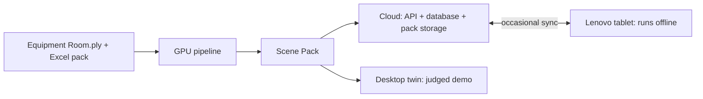

# Architecture: Valmet field-service copilot

**Status:** proposed, nothing below is built or tested yet. Items marked "test" must be proven first.
**Sources:** Valmet's challenge brief (Word) and Builder Pack (Excel).
**Deadline:** Sunday 10:00, fixed.

## 1. The system in short

The **cloud** holds the master data. The **GPU pipeline** turns the scan into a Scene Pack. The
**tablet** downloads that pack, then works fully offline and syncs when it has a connection.

| Part | Runs on | Job | Needs internet? |
|---|---|---|---|
| GPU pipeline | RTX 5090, LUMI for large batches | Extract assets, build floor map, train models, build the pack | Only for downloads |
| Cloud | VPS with Docker Compose | Master data, pack storage, sync, cloud LLM | Yes |
| Desktop twin | Laptop browser | Full-quality simulation for the judged demo | No, once loaded |
| Tablet app | Lenovo tablet (Android) | Twin + camera, search, voice, AI, route | No, only for sync |

## 2. Valmet's requirements

| Requirement (Word) | Score | Our solution | Proof in the demo |
|---|---|---|---|
| Extract and 3D-frame as many assets as possible | 30% | Multi-view SAM masks lifted to splats, plus geometric clustering | Count of framed assets, labelled views |
| Collision-free route to the faulty device | 25% | Occupancy grid + A*, checked by an automated test | Avatar walks a logical route, collision test passes |
| Show nearby assets while walking | Part of 25% | Radius search around the avatar | Frames and status cards appear and disappear |
| Map Excel data, including a faulty target | Part of 30% | Class-aware procedural mapping, target `P-005` | Each frame shows real Excel values |
| AI diagnosis on arrival | 20% | Retrieval + LLM, answer rules enforced by code | Answer cites evidence IDs and confidence |
| Structured, automated backend | 15% | `make pipeline` stages, each with a saved output | Rebuild from the `.ply` with one command |
| Clear, reliable demo | 10% | Simple viewer, recorded backup | Video shows it working in the first 20 seconds |

| Must submit | Owner | Status |
|---|---|---|
| Working demo, runnable or clearly recorded | TBD | Not started |
| Repository with README and setup steps | TBD | Started |
| 5–8 slides on pipeline, pathfinding, mapping and AI | TBD | Not started |
| Demo video, 5 minutes max (Word); event guide prefers under 2 | TBD | Not started |
| Technical note on models, libraries and components | TBD | Not started |

| Extra from Excel | Priority | How we cover it |
|---|---|---|
| Q-01 Asset, state, evidence and documents in 3D | P0 | Tap a frame to open its card |
| Q-02 Detect degradation from telemetry | P0 | Train an anomaly model on telemetry |
| Q-03 Evidence IDs and confidence on every diagnosis | P0 | Required answer format, IDs checked by code |
| Q-05 3D object to work-order draft on tablet | P0 | Draft button; never a real control action |
| Q-06 Lower confidence for poor data | P0 | Apply `Data_Quality` and `mapping_confidence` |
| Q-04 Prioritise work | P1 | Score from health, criticality and uncertainty |
| Q-07 Replaceable data feeds | P1 | Data source interface behind the API |
| Q-09 Portable across 3D platforms | P1 | Plain files: splats, JSON and glTF frames |

## 3. GPU pipeline

Each stage reads the last stage's files and saves its own, so one stage can be rerun alone.

| # | Stage | Method | Tools | Output |
|---|---|---|---|---|
| 1 | Clean scan | Remove low-opacity splats and floaters, level the floor, check real-world scale | NumPy, Open3D | `clean.ply` |
| 2 | Render views | Generate cameras through the room; save colour, depth and splat ID | Gaussian splat renderer | `views/` |
| 3 | Segment | Automatic masks for each view | SAM 2 | `masks/` |
| 4 | Lift to 3D | Map masks to splat IDs, merge across views by overlap voting | Own code | `instances.npz` |
| 5 | Find the rest | Cluster leftover splats, fit cylinders for pipes | DBSCAN, RANSAC | More instances |
| 6 | Label | Match crops to prompts: valve, pump, motor, sensor, pipe, tank, cabinet, ladder, box | CLIP or SigLIP, cloud vision LLM for hard cases | Class + confidence |
| 7 | Frame | Oriented 3D box per instance | PCA, Open3D | `assets.json` |
| 8 | Floor map | Find floor, mark occupied voxels, widen obstacles by body radius | Own code | `nav_grid.npz` |
| 9 | Map data | Match class to `asset_class`, assign remaining rows procedurally | Pandas | `asset_map.json` |
| 10 | Train | Telemetry anomaly model; tablet detector on labelled renders | PyTorch, PyOD | Models |
| 11 | Pack | Reduce splats to the tablet's budget, split by asset, add version and checksums | Own code | `scene_pack_vN.zip` |

Rules: never guess identity silently. Extra objects keep their visual class and are shown as
`procedural` or `unmapped`, with `mapping_confidence` (Excel's `DOC-3D-MAPPING`).

## 4. Simulation

| Feature | How it works | Done when |
|---|---|---|
| Route | A* on the floor grid, then smooth the path; goal is the nearest walkable cell to the target | Automated test: no path point touches an occupied cell |
| Avatar or robot | A simple 3D model follows the path | Moves at walking speed and never clips |
| Nearby assets | KD-tree query around the avatar, e.g. 2.5 m | Frames and cards update while walking |
| **Pick up and move** | Each asset is its own splat group. Grab it, attach it to the hand, drop it on the floor | Object moves as one piece |
| **Replan after a move** | Moving an object updates the grid, then A* reruns | Route changes when an object blocks the way |
| **Keep the change** | Save `asset_id` + new position to the change log and sync it | Survives restart, reaches the cloud |

Moving limits: the scan has no data behind an object, so a hole stays where it stood. Only objects
marked `movable` can be picked up (boxes, carts). Moving fixed plant is a labelled what-if.

## 5. Tablet app

Lenovo tablet, Android. **Layout:** live camera and 3D twin side by side, asset list on the right,
search on top.

| Feature | How it works | Tools | Fallback |
|---|---|---|---|
| App shell | Native camera and AR; twin in an embedded web view | Kotlin, ARCore, WebView | Web view only, no AR |
| **VR + real camera together** | Both panes share one position, so moving the tablet moves the twin | ARCore pose sent to the twin | Move the twin by touch |
| Find position | Scan a QR marker at a known spot, then track from there | ML Kit, ARCore | Pick a spot on the map |
| 3D twin | Same viewer code as desktop, reduced scene | Three.js + Spark or similar (test) | Show frames and floor only, no splats |
| Identify an object | QR or NFC first, then camera detector with confidence | TFLite or ONNX Runtime | Choose from the list |
| Item list and search | Search by name, tag or status; shows a picture of the item | SQLite FTS5 | None needed |
| Label by a box | Tap a box to show its name, status and health | Canvas overlay | Card in the list |
| Voice question | Speech to text on the device | Android speech or whisper.cpp | Type the question |
| AI answer | Short written and spoken reply using local data | llama.cpp small model, Android text-to-speech | Fixed templates over database results |
| Floor direction | A* route shown as arrows on the camera floor and on the map | ARCore, local A* | 2D map only |
| Work-order draft | Fill in from the diagnosis, send at next sync | SQLite outbox | None needed |

**Testing limit:** the real room isn't at the venue, so real-camera tracking is demonstrated with
printed markers and the provided videos, and must be labelled that way in the demo. Matching a
camera to the scan without markers is out of scope.

## 6. AI copilot

| Step | What happens | Why |
|---|---|---|
| 1. Identify | Asset comes from the selected frame or the question | No guessing identity |
| 2. Retrieve | Code fetches state, telemetry, events, history, service cases and docs | The LLM only sees real records |
| 3. Generate | Cloud LLM on desktop or when online; small local model on the tablet | Works offline |
| 4. Check | Code confirms every cited ID exists, then lowers confidence for poor data | Grounded and explainable |
| 5. Safety | Recommend verification and escalation only (`DOC-FIELD-SAFETY`) | Never replaces site procedures |

Every answer (`DOC-RAG-GUIDE`): asset name, observation, hypothesis, evidence IDs, confidence,
next safe check.

**Demo target:** `P-005`, fouling, health 44, production critical, confidence 0.91.

## 7. Data and sync

| Data | Cloud | Tablet |
|---|---|---|
| Assets, state, events, history | PostgreSQL | SQLite |
| Telemetry | TimescaleDB | Recent window in SQLite |
| Document search | pgvector | SQLite FTS5, optional vectors |
| Scene, models | Pack storage | App files |
| Moved objects, drafts, notes | PostgreSQL | SQLite outbox |

| Sync step | Route | Rule |
|---|---|---|
| Check for updates | `GET /api/sync/manifest` | Compare pack version and checksum |
| Download | `GET /api/sync/packs/{version}` | Verify checksum, keep the old pack until the new one is ready |
| Upload changes | `POST /api/sync/changes` | Outbox with unique IDs, safe to retry |
| Conflicts | Server decides | Latest change wins, and the conflict is logged |
| When | Sync button, or automatically on Wi-Fi | App stays fully usable offline |

**Cloud API (from the Excel):** `GET /api/assets`, `/api/assets/{id}`, `/telemetry`, `/events`,
`/documents`, `GET /api/scene/anchors`, `POST /api/copilot/query`, `POST /api/work-orders/draft`.

## 8. Development and deployment

| Environment | Machine | Used for | How it ships |
|---|---|---|---|
| Development | ThinkPads | Code, small CPU runs | `uv`, branches and PRs |
| GPU | RTX 5090 (shared) | Pipeline, training | `make pipeline`, outputs kept out of git |
| Large jobs | LUMI | Extra rendering or training | `lumi/`; AMD GPUs and no Docker, so GPU-only code needs testing |
| Cloud | VPS | API, database, packs | Docker Compose + Caddy HTTPS, reuse `deploy/` from `full-setup` |
| Tablet | Lenovo tablet | Offline app | Signed APK, sideloaded |
| CI | GitHub Actions | Lint, tests, APK build | Runs on PRs, no heavy dependencies |

| Rule | Why |
|---|---|
| Never commit the `.ply`, packs or checkpoints | Too large; share outside git |
| Pack has a version and checksum | Tablet and cloud always know what they're running |
| `.env` for keys, listed in `.env.example` | No secrets in git |
| Record a backup video before the deadline | The fixed deadline allows no retries |

| Repo folder | Contents |
|---|---|
| `pipeline/` | Stages 1–11 |
| `sim/` | A*, avatar logic, object moves |
| `copilot/` | Retrieval, answer rules, LLM clients |
| `server/` | Cloud API and sync |
| `viewer/` | Shared 3D twin |
| `tablet/` | Android app |

## 9. Build order

Each gate must work before the next starts. **Gates 1–3 cover Valmet's written requirements.**
Gates 4–5 are our extras and aren't directly scored in the Word brief, so ask Valmet how much they
count.

| Gate | Target | Delivers | If late |
|---|---|---|---|
| 1 | Sat 02:00 | Scene loads, first 3D frames, floor map, basic route | Use geometric clustering only |
| 2 | Sat 12:00 | Full loop on desktop: walk, nearby cards, Excel data, diagnosis | Stop new work until this runs |
| 3 | Sat 20:00 | Many more frames, anomaly model, safety rules, pick up and move | Reduce object labels |
| 4 | Sun 02:00 | Tablet: offline twin, list, search, typed AI, basic sync | Show tablet in the video only |
| 5 | Sun 05:00 | Camera + twin together, voice, local LLM, floor arrows | Cut in this order: arrows, local LLM, voice, AR |
| Freeze | Sun 06:00 | Bug fixes, video, slides, note, zip | No new features |
| Submit | Sun 09:00 | Submit early, then check every link | Deadline is 10:00 |

## 10. Risks and open questions

| Risk or question | Level | Action |
|---|---|---|
| Too much for the time left | High | Follow the gates and cut from the end |
| Splats too heavy for the tablet | High | Test early; reduce or drop splats on the tablet |
| Which Lenovo model? ARCore and RAM limit AR and LLM | High | Check today |
| Weak or merged object masks in a dense room | Medium | Combine with clustering, tune on one area first |
| No walkable path found | Medium | Check the floor grid early, relax body radius carefully |
| Detector trained on renders fails on real camera | Medium | QR and NFC come first; report results honestly |
| Scene scale may not be true metres | Medium | Check against known objects |
| `Equipment Room.ply` isn't the file named in the brief | Ask Valmet | Boiler Room copy is 66.6% corrupt; pipeline accepts any scene file |
| Full telemetry CSV and 38 RAG docs are missing | Ask Valmet | Use the 3-day sample and core docs until then |
| Does the tablet app count, given the Word brief says to focus on the backend? | Ask Valmet | Excel Q-05 lists tablet workflows as P0 |
| Does "VR" mean a headset? | Team decision | Assumed a 3D twin on screen; a headset is out of scope |
| Ultralytics YOLO is AGPL-3.0 | Check | Prefer a permissive detector such as YOLOX |
