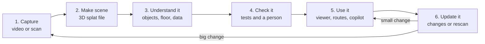
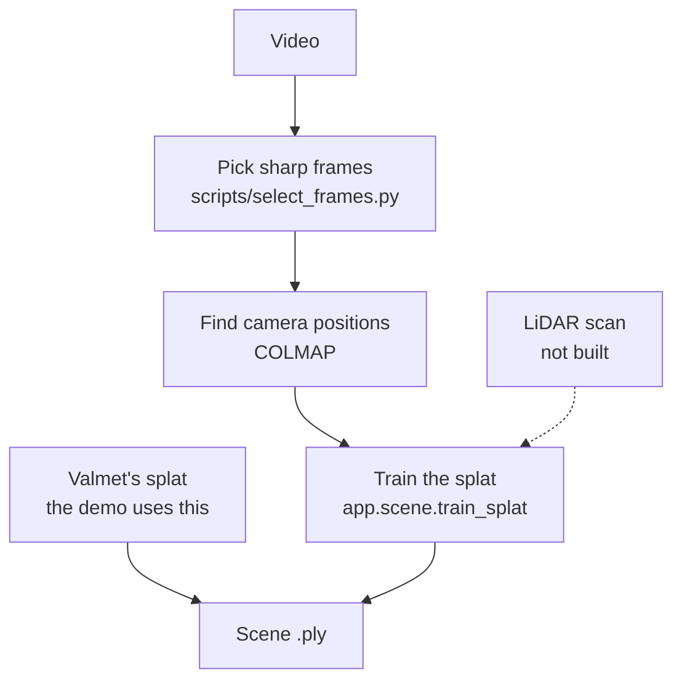
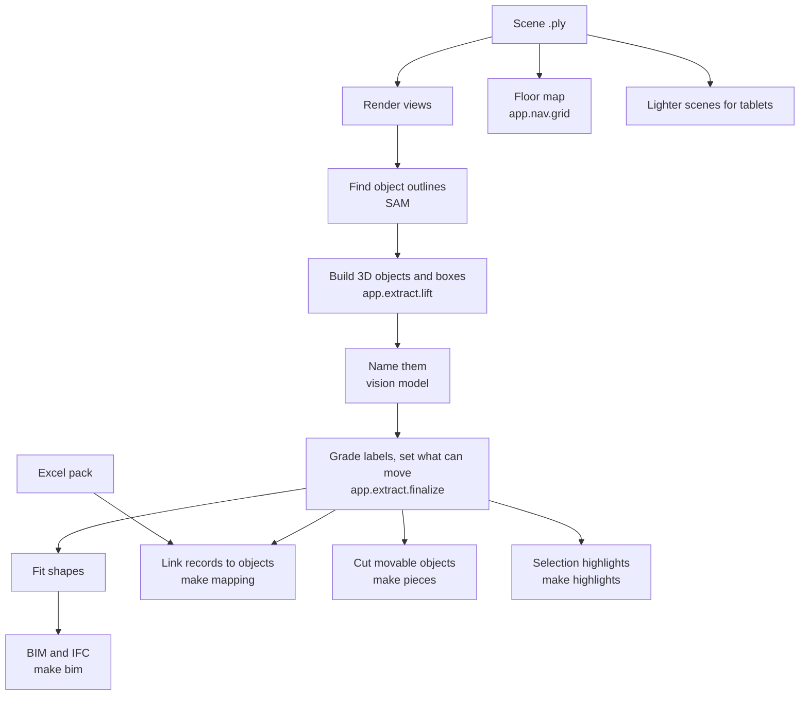
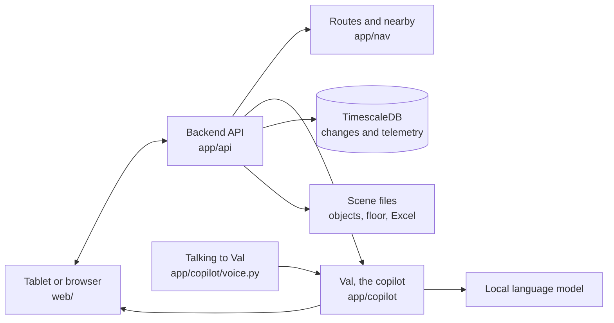
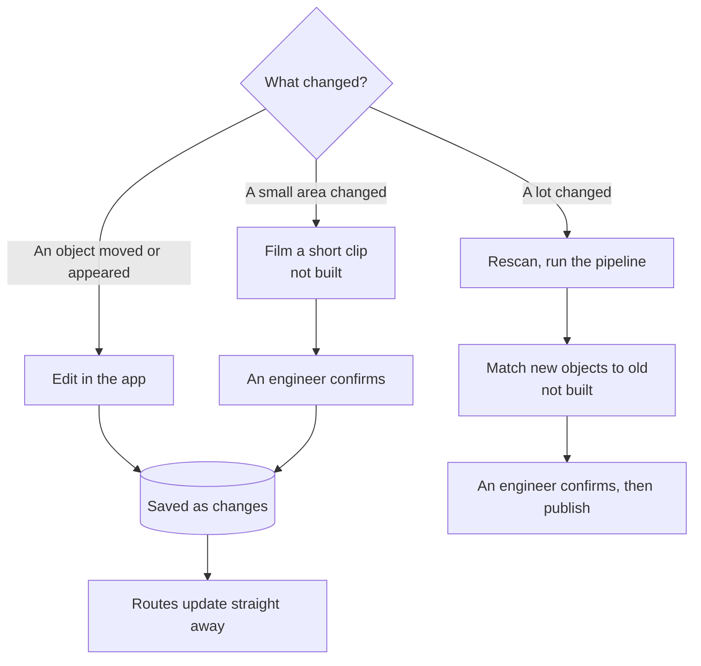

# Architecture

Everything runs on site: one GPU server, and a tablet or browser on its network. No internet in use.

## The whole system

| Stage | Goes in | Comes out | Status |
|---|---|---|---|
| 1. Capture | The room | Video or scan | Video done. LiDAR not built |
| 2. Make scene | Video or scan | Splat `.ply` | Works by hand. Demo uses Valmet's file |
| 3. Understand it | Splat, Excel | Objects, floor map, links | One command, only a dry run so far |
| 4. Check it | All outputs | Pass or fail, what needs a person | Works |
| 5. Use it | All outputs | The live demo | Works on a laptop. The zip is untested on Windows and Mac |
| 6. Update it | Moves and edits | Saved changes | In-app done. Clip and rescan not built |

## 1–2. From recording to scene

- Never clean anything people see. It leaves black holes.
- A scene must be in metres, and its config must say which way is up.
- Our own splat looks worse than Valmet's, so only use it for a new room.
- Each room needs one config: copy `scenes/equipment_room.toml`.

## 3. From scene to data

**Run it:** `make pipeline CONFIG=scenes/equipment_room.toml`. Finished steps are skipped, so a failed
run continues. `DRY=1` shows the steps. Mapping, pieces, highlights and BIM are separate commands today.

## 4. Testing

| Check | Command | Proves |
|---|---|---|
| Code | `make check` | Lint and tests pass |
| Everything together | `make nav-check` | Floor, routes, links, copilot and moves work on real data |
| Routes against the scan | `scripts/check_routes.py` | Routes don't pass through solid splats |
| A person | Open the viewer, read the report | Labels, `P-005` and routes look right |
| The rehearsal | Demo laptop, internet off, and the zip on another laptop | The real demo works |

## 5. Using it

Start it with `./start laptop`, `./start browser` or `./start tablet`, or on someone else's laptop from the zip
that `make bundle` builds, which holds the demo's backend, viewer and data, with its own Python packages and no
torch. The browser's graphics draw the scene, and the server only answers the API and Val, so a small machine is
enough to serve it. Without a language model, Val answers from the records.

## 6. Updating the space

The original scan is never overwritten, so **Undo changes** can always go back.

## Clean-up

| What | Problem | Do this |
|---|---|---|
| `make pipeline` | Only had a dry run | Run it for real on a GPU machine |
| Mapping, pieces, highlights, BIM | Separate from the pipeline, in a set order | Add them as pipeline steps |
| `make scene` and `make pipeline` | Two ways to get the same files | Download for the demo, pipeline for a new room |
| `app/extract/masks`, `merge`, `label` | A second extraction route nobody runs | Pick one route and retire the other |
| `app/scene/cluster.py`, `split.py` | Early versions, replaced for the demo | Check they're unused, then remove |
| `app/train.py`, `make train`, `make up` | Starter template, not in the demo | Remove |
| `make scene-full`, own-splat steps | The demo doesn't use them | Keep only for new rooms, and say so |
| 16 buttons at once | Too much on screen | Simplify (Viktor's next task) |
| `docs/` | Plan and usage repeat each other | Plan for tasks, usage for steps, this for the picture |

**Order:** rehearse first, then clean up. Don't remove anything right before the demo unless tests pass.
